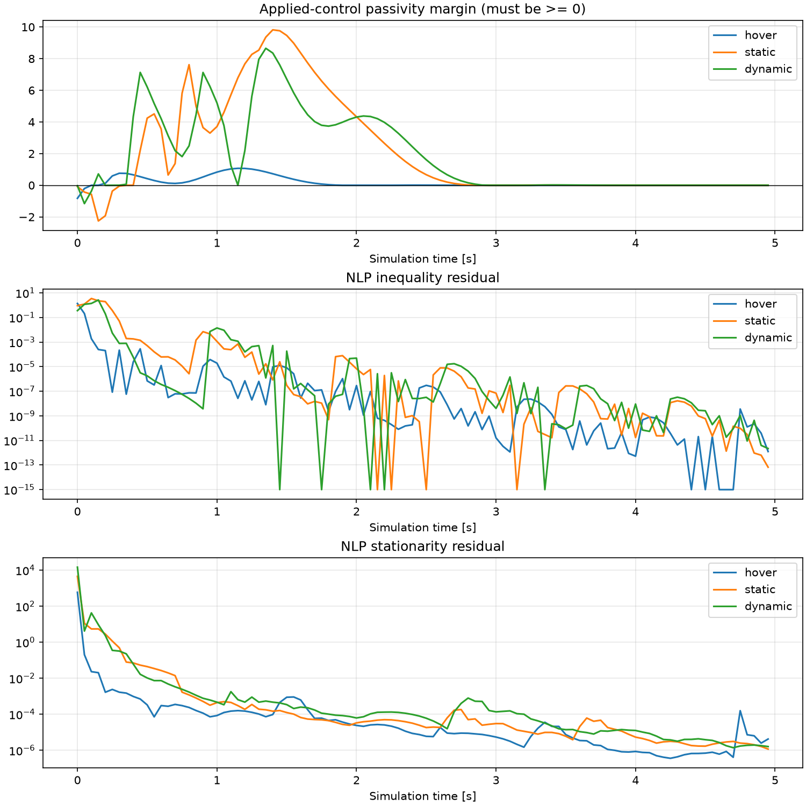

# 40 节点 acados 验证归档

本目录归档对仓库初始实现的数值验证，以及对 arXiv:2603.08860v1 的公式核对。**环境安装与闭环运行已完成，但全程约束可行性未通过，不能认定论文复现成功。**

| SQP-RTI 场景 | 控制步数 | 最终位置误差 m | 最小无源裕量（须 ≥0） |
|---|---:|---:|---:|
| hover | 100/100 | 0.0000157 | −0.8260 |
| static | 100/100 | 0.000301 | −2.2562 |
| dynamic | 100/100 | 0.000671 | −1.1598 |

三个场景最终残差下降，但早期有显著无源约束违反，预测轨迹也有 HOCBF 违反。默认完整 SQP 均在首步达到迭代上限。静态场景增加线搜索、正则化及迭代次数仍未收敛。详情见 [REPORT.md](REPORT.md)；论文参数差异、印式一致性与复现边界见 [PAPER_AUDIT.md](PAPER_AUDIT.md)。



## 文件

- `runs/`：三场景 SQP-RTI、三场景完整 SQP、额外静态 SQP 对照，以及此前 IPOPT 基线的原始 `.npz`、图像与诊断 JSON。失败运行的 `failed` 标志和零步结果保留，不能当作通过。
- `logs/`：原始控制台运行日志与 CMake 配置日志。日志中的绝对路径来自本次云环境；日志可能包含提示和数值警告。
- `summary.json`：三场景 RTI 汇总；`paper_audit.json`：公式数值反例。
- `diagnose.py`：外部观测包装器；`summarize.py`：从归档数据重新汇总；`audit_paper.py`：重新计算公式检查。
- `metadata.json`：软件版本和提交信息；`SHA256SUMS`：归档文件校验清单。

## 复算与复跑

先按仓库 README 安装 Python 依赖及 acados。此次 acados 固定提交为 `5b74695a51c09637664318f7c9b2f1ee2efa05b7`，包含该提交指定的递归子模块；Tera Renderer 为 v0.2.1。所有脚本从自身路径定位仓库，支持其他检出目录。

从仓库根目录运行：

```bash
# acados 实际安装位置，不要照抄一个不存在的路径
export ACADOS_SOURCE_DIR=/path/to/acados
export LD_LIBRARY_PATH="$ACADOS_SOURCE_DIR/lib:${LD_LIBRARY_PATH:-}"
export OPENBLAS_NUM_THREADS=1 OMP_NUM_THREADS=1

python -m unittest discover -s tests -v
python validation/acados_40_nodes/audit_paper.py
python validation/acados_40_nodes/summarize.py

# 新运行写入被忽略的 results/，保留本次归档
python validation/acados_40_nodes/diagnose.py \
  --solver acados --scenario static --nodes 40 --horizon 2.0 \
  --steps 100 --output results/recheck_static_acados
```

将 `static` 换成 `hover` 或 `dynamic`；加 `--full-sqp` 使用仓库默认完整 SQP。静态额外对照设置为：

```bash
SEP_SQP_GLOBALIZATION=1 python validation/acados_40_nodes/diagnose.py \
  --solver acados --scenario static --nodes 40 --horizon 2.0 \
  --steps 100 --full-sqp --output results/recheck_static_sqp_globalized
```

该选项明确覆盖为 `MERIT_BACKTRACKING`、`levenberg_marquardt=1e-3`、`nlp_solver_max_iter=300`，不是已验证的修复。诊断中的残差重算适用于标准 SQP-RTI，不能直接移植到 AS-RTI。

本次控制周期为 0.05 s，非论文硬件实验的 0.01 s；并发云机器计时不构成硬实时性能证明。未修改 `sep_nmpc/`、`run_sim.py`、原测试或依赖声明。本文 PDF、第三方依赖源码和本地编译产物不包含在归档中。
